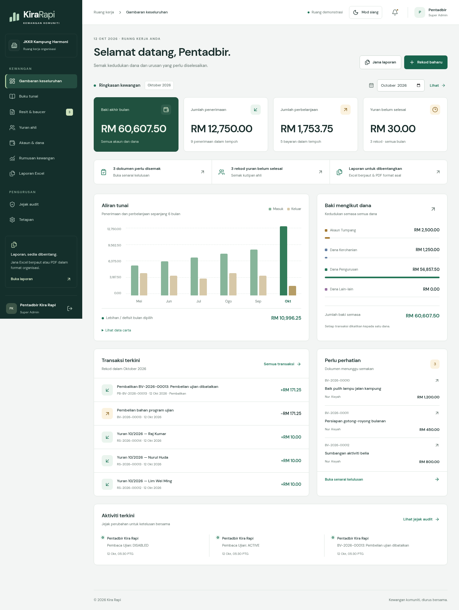
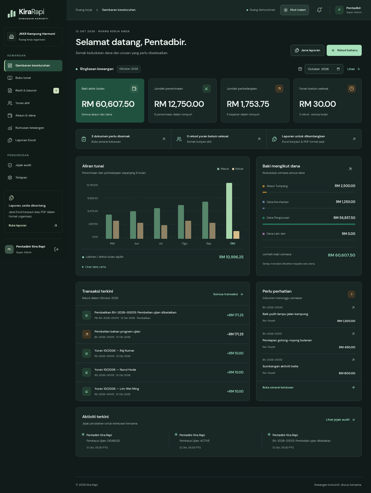

# Kira Rapi UI/UX design

Visual direction: modern corporate with jade green, DM Sans typography and financial screens that put balances and daily actions first. The interface supports Malay and English.

## Workflow

- **Dashboard:** financial summary, shortcuts to documents awaiting review, outstanding dues and the report generator. The six-month chart also provides its data in table form.
- **Navigation:** financial and management modules are separated in the sidebar. The current page is marked and a new-record button is available on the dashboard.
- **Excel reports:** an overview of the four workbooks, period and report-type options, the funds-account fund and the column mapping. Further mapping can be expanded when needed. A usage guide sits next to the generation controls.
- **Forms and status:** labels, short descriptions, icon-based success/error messages and loading states use shared components.

## Day and night mode

The moon/sun button is available on the workspace, sign-in and registration screens. The choice is stored in that browser under `kira-rapi-theme`. Without a stored choice the application follows the device theme setting, including when that setting changes. Choosing a theme in another tab applies here too.

The theme is applied before the first content renders to reduce flashes of the wrong theme. Background, text, form, table and status colours use the same CSS variables throughout the application.

Theme rules are limited to on-screen presentation. Document previews stay like white paper; summary printing and Excel/PDF output keep their original formatting. Financial calculations, the database schema and the four template files were not changed by the redesign.

## Phone and keyboard

The BM/EN control is available on desktop and phone, including the sign-in and registration screens. Malay is the primary language. The choice is stored in the `kira-rapi-lang` cookie and read on the server; switching language preserves the URL and filters, the theme and any unsent form input. Report content, stored category values and user records are not translated.

The sidebar becomes an expandable menu at widths up to 1100px. When the menu opens, focus moves inside it, Tab/Shift+Tab stay within it and the background content cannot be activated. Escape closes the menu and returns focus to the opening button. The menu closes when a link is chosen or the viewport returns to desktop size.

Cards and forms reflow with viewport width. Long tables scroll inside their container. Focus indicators are visible, a skip-to-content link is provided, and the device setting for reduced motion is respected.

## Maintenance and verification

- Colour tokens and responsive rules: `app/globals.css`.
- Initial theme: `app/layout.tsx`; theme control: `components/theme-toggle.tsx`.
- Language: `lib/i18n.ts` holds the dictionary; `lib/i18n-server.ts` reads the cookie; `components/language-toggle.tsx` and `app/language-actions.ts` change the language choice.
- Navigation and focus management: `components/shell.tsx`.
- Theme, desktop/phone, menu focus and printing from night mode scenarios: `tests/e2e/design.spec.ts`.
- Document flow and Excel/PDF downloads: `tests/e2e/app.spec.ts`.
- Server-side language without JavaScript, cookies, filters, forms, phone and Malay output: `tests/e2e/i18n.spec.ts`. The tests compare the XML content of the four workbooks between UI language choices, including formulas, styles and links. Only generation-time metadata is excluded from the comparison.

Run `npm run build` followed by `npm run test:e2e`. The tests use a separate fixture database and produce screenshots and PDFs in `.data/screenshots`. Review results are in the [operations guide](OPERATIONS.md).

| Day mode                                         | Night mode                                               |
| ------------------------------------------------ | -------------------------------------------------------- |
|  |  |
